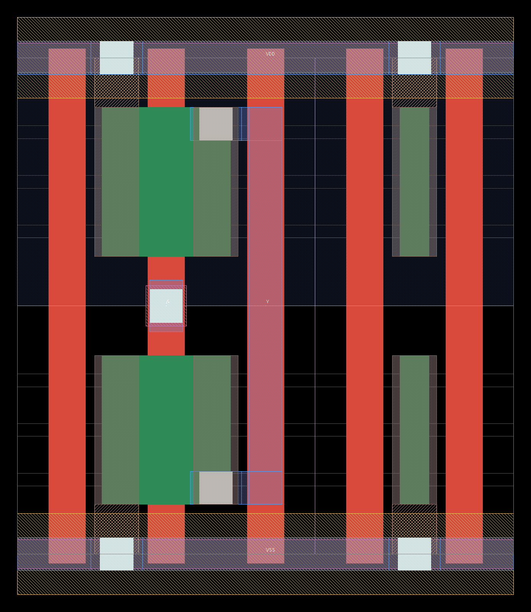
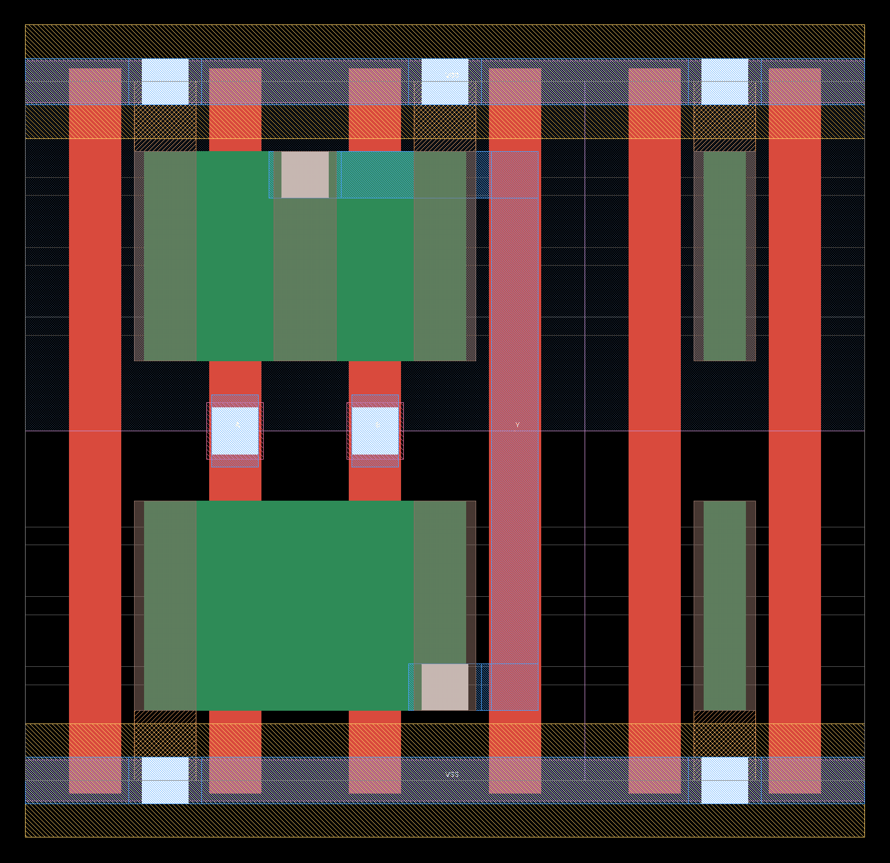
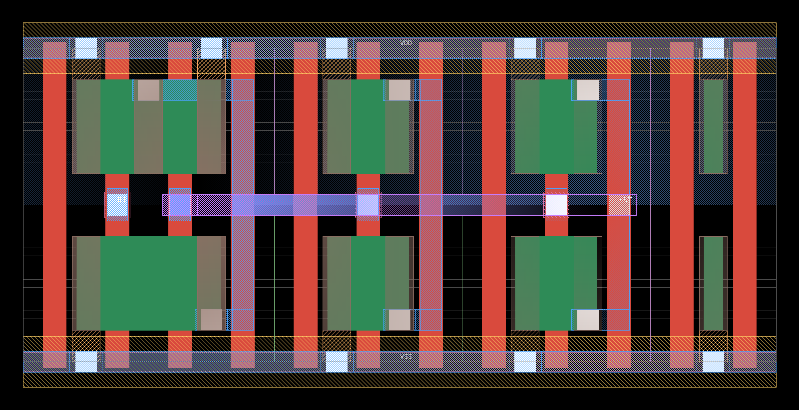

# ICL canvas: unrestricted layout from plain Python, on any described PDK

The canvas is the level under the ICL language. A canvas file is an ordinary Python script, so
loops, functions, arithmetic and parameters are free. It can put **any shape on any layer of the
PDK** (rectangles, polygons at any angle, paths), build hierarchy with arrays, and declare any
device for LVS. Nothing in it is specific to one process: the PDK is a data file, and the same
script builds on every PDK that has one.

Rule of the design: **no helper is a ceiling.** `mos`, `via`, `stick`, `Router` save work, but all
of them only draw ordinary shapes into the cell, and a hand-drawn rectangle is always allowed next
to them. If a helper cannot do something, draw it.

```
bin/icl check   f.py --pdk sky130A      # build + DRC (magic and the PDK's KLayout deck) + netgen LVS
                                        # exit 0 clean / 1 violations / 2 script error
bin/icl check   f.py --pdk gf180mcuD    # the same script on another PDK
bin/icl check   f.py --pdk freepdk45    # and on a 45 nm one
bin/icl check   tests/asap7/inv.py --pdk asap7   # 7 nm FinFET: shapes, mos / tap / via (section 11)
bin/icl inspect f.py --pdk gf180mcuD    # print the PDK rule sheet (layers, stack, rules, device recipes)
bin/icl build   f.py --pdk ...          # GDS + SPICE only, no signoff
options: --top NAME (default: the variable TOP, else the last cell made)   --no-lvs   --no-klayout
         --out DIR   --json
         --ref X.spice (LVS against this netlist instead of the script's own device declarations)
```

Outputs go to `build/<script>.<pdk>/`: `<top>.gds`, `<top>.spice` (reference netlist), `<top>.png`,
`report.json`. Violations are reported with the DRC rule text, the box, and the script lines that
drew the shapes under the box.

## 0. Choose the level first

| the task gives you | start with | then |
|---|---|---|
| a netlist, whatever the devices (transistors, resistors, capacitors) | `TOP = from_spice("netlist.spice")`, three lines, no coordinates (section 8) | `check` it. Redraw by hand only the part that has to be different |
| a function or a schematic, no netlist | `stick_auto` / `stick`, `rows`, `Router` (sections 6, 7), `mos_strip` (8) | |
| a shape: an inductor, a pad, a test structure, a device without a recipe | `rect` / `polygon` / `path` (section 3) | |

The levels mix freely, because every helper only draws ordinary shapes. Placing 64 capacitors or 600
transistors by coordinates is the slowest way to a clean layout: do it only for what the netlist
level cannot express, and after the netlist level has given a clean starting point.

## 1. Minimal script

```python
from icdsl.canvas import *

tech = use()                                   # PDK from --pdk / $ICL_PDK (default sky130A)
c0 = tech.c0                                   # first conductor above the devices
c = Cell("inv")
n = c.mos("nmos", w=0.65, gates="A", sd=("VSS", "Y"), at=(0, 0))
p = c.mos("pmos", w=1.0,  gates="A", sd=("VDD", "Y"), at=(0, n.diff.top + 1.2))
g = c.rect("poly", x0=n.gates[0].left, x1=n.gates[0].right, y0=n.gates[0].top, y1=p.gates[0].bottom, net="A")
...
c.port("A", on=some_shape, dir="in")
```

The full version is `examples/canvas/inv.py` (clean on sky130A, gf180mcuD and freepdk45).
Units are micrometres everywhere; coordinates are snapped to the PDK grid.

## 2. Portable names

Write scripts against roles, not against one PDK's layer names.

| name | sky130A (130 nm) | gf180mcuD (180 nm) | freepdk45 (45 nm) | meaning |
|---|---|---|---|---|
| `tech.c0` | li | m1 | m1 | first conductor: device terminals land here |
| `tech.c1 .. c4` | m1 .. m4 | m2 .. m5 | m2 .. m5 | conductors above it (`tech.conductor(i)`) |
| `tech.metal(k)` | m1.. | m1.. | m1.. | the PDK's own "Metal k" |
| `tech.stack` | li m1 .. m5 | m1 .. m5 | m1 .. m10 | all conductors, bottom to top |
| `"poly"`, `"diff"`, `"nwell"`, `"contact"` | | | | short layer names, same on every PDK |
| recipes `nmos pmos ptap ntap` | yes | yes | yes | device kinds for the PCells |
| recipes `res_poly cap_mim` | yes | yes | no (the PDK has no such device) | test with `"res_poly" in tech.d["devices"]` |

Rules as numbers: `tech.width(layer)`, `tech.space(a, b=None, width=None)` (`width=` gives the larger
spacing a wide shape needs, on PDKs with width-dependent metal spacing), `tech.enc(outer, inner)` (all
sides, two opposite sides), `tech.area(layer)`, `tech.rule(name)` (named rules such as
`gate_contact_space`, `poly_endcap`, `tap_diff_space`, `latchup_dist`), `tech.snap(um)`, `tech.grid` (nm).
`tech.describe()` prints the whole sheet; `tech.d` is the raw data dict.

Every other layer of the PDK works too: by its short name from the sheet, by its official name, or
as a raw `(gds_layer, datatype)` tuple. Nothing is filtered.

## 3. Drawing

```python
r = c.rect("m1", x0=0, y0=0, x1=1, y1=0.2, net="A")          # absolute
s = c.rect("m1", w=0.2, h=1, right_of=r, bottom=r.bottom)    # relative; space= defaults to the PDK rule
c.box("m2", other.bbox)                                       # from an (x0, y0, x1, y1) tuple
c.polygon("m3", [(0, 0), (4, 0), (2, 3)], net="X")            # any polygon
c.path(tech.stack[-1], pts, 4.0, net="L")                     # any-angle path, ends = flush | ext | round
c.wire("m1", [a, (5, 2), b], width=0.3, net="A", first="h")   # Manhattan wire through points / shape centres
c.label("A", "m1", at=r)                                      # net-name text
c.port("A", on=r, dir="in")                                   # pin (top-level pins become GDS labels)
```

Keywords of `rect`: x by `x0 x1 | left right cx | xspan=(a, b) | right_of= left_of=` plus `w=`;
y by `y0 y1 | bottom top cy | yspan= | above= below=` plus `h=`; `inside=obj` centres on / fills it.
Every shape has `.left .right .bottom .top .cx .cy .w .h .bbox`. `net=` is not required, but named
shapes are what the in-process connectivity pre-check and the error attribution use.

Take the edges of a helper's shape from the shape (`pad.bottom`, `pad.top`), do not recompute them as
centre +- size / 2: where a minimum size is an odd number of grids (the 65 nm contact of freepdk45 on
its 5 nm grid) the shape is half a grid off centre, the same way in `via`, `mos` and `wire`.

**45 degree paths are exact.** When every segment of a path is Manhattan or 45 degrees, the outline
has only Manhattan / 45 degree edges with on-grid vertices (diagonal legs up to 1.5 grids wider than
asked, never narrower), so octagonal inductors and 45 degree buses pass DRC. Other angles are snapped
to the grid and may produce off-angle edges that some decks flag; the shape is drawn as asked and the
check report gets a `note:` line with the statement, the segment and its angle (a 45 degree segment has
`|dx| == |dy|`).

## 4. PCells (driven by the PDK data)

```python
v  = c.via(c0, tech.c2, at=(x, y), nx=2, ny=1, net="A", dir="h")     # cut stack with pads; v.lower / v.upper
sz = c.via_size(c0, tech.c1)                                          # {layer: (w, h)} of those pads, nothing drawn
m  = c.mos("nmos", w=2.0, l=0.5, nf=4, gates="G", sd=("S", "D"), at=(0, 0))
     # m.diff, m.gates[i] (poly), m.sd[i] (c0 strap per source/drain column), m.gx[i], m.sx[i], m.well
t  = c.tap("ptap", x0=.., y0=.., x1=.., y1=.., net="VSS")             # t.strap (c0), t.diff, t.well
gr = c.guard_ring("ntap", around=[m1, m2], net="VDD", space=1.0)      # closed ring; gr.inner / gr.outer / gr.straps
     # gr.bottom_bar / top_bar / left_bar / right_bar (.strap = the c0 bar); its well covers the whole
     # interior (well=False: no well drawn, draw your own)
r  = c.resistor("res_poly", w=1.0, l=8.0, at=(x, y), nets=("a", "b"), orient="v")    # r.a / r.b pads
cc = c.capacitor("cap_mim", w=20, h=20, at=(x, y), nets=("top", "bot"))               # cc.top_pad, cc.bottom_pad
```

`mos`: `gates` = one net or `nf` nets; `sd` = `nf + 1` nets or an (S, D) pair that alternates;
`contacts=[...]` drops contact columns (stacks); `pitch=`, `gate_ext=`, `well=False`, `origin="col"`.
PCells record their devices for the reference netlist. Any other device: draw it and declare it,

```python
c.device("Q1", "sky130_fd_pr__pnp_05v5_W0p68L0p68", ["c", "b", "e"])   # any model the extraction deck knows
```

Finished cells from elsewhere: `pdk_cell("sky130_fd_sc_hd__inv_1")` (PDK library cell with its real
GDS and SPICE), `import_gds(path, cellname, spice=...)` (any GDS; ports from its labels).

## 5. Hierarchy

```python
i = top.place(cell, at=(x, y), orient="R0", name="U1", conns={"A": "net1", "Y": "out"})
a = top.place(bit, nx=8, ny=16, name="B", conns={"BL": "bl{x}", "WL": "wl{y}"})   # array; pitch = dx=, dy=
i.pin("A")            # the port's rectangle in parent coordinates (arrays: ix=, iy=)
```

Orientations `R0 R90 R180 R270 MX MY MXR90 MYR90`. Relative placement keywords as for `rect`
(`right_of=`, `above=`, ...). `conns` names the parent net of each port: it is the reference netlist
for LVS and the input of the connectivity pre-check, it draws nothing. A port not listed connects to
the parent net of the same name.

## 6. Stick cells and rows (CMOS logic without coordinates)

```python
inv  = stick("inv",   n="VSS A Y",     p="VDD A Y",       ports="A Y",   ntracks=3)
nand = stick("nand2", n="VSS A x B Y", p="VDD A Y B VDD", ports="A B Y", ntracks=3)
```

Cells that share a row must have the same height: give them the same `wn`, `wp` and `ntracks`
(`rows` says so if they differ). A strip reads left to right: source/drain net, gate net, source/drain net, ... Both strips have the
same number of columns. `-` in a gate position: no transistor (diffusion break); `-` in a
source/drain position: no diffusion in that column. Different n and p gate nets in one column split
the poly (pass gates, clocked inverters). Options: `wn= wp= l= ntracks= tracks={net: index}`.
Ports are horizontal tracks on `c1` that span the cell, so a parent can reach a port at any x.
Internal wiring conflicts are solved with extra tracks and jumper columns automatically.

```python
insts = rows(top, [[(inv, "U1", dict(A="in", Y="n1")), (nand, "U2", dict(A="n1", B="en", Y="out"))],
                   [...]])          # rows bottom to top, every other row mirrored, shared rails, VDD / VSS ports
```

`rows` returns `{instance name: Ref}` (a dict, not a list): `insts["U2"].pin("Y")` is the port strip in
`top` coordinates. `cell.stick` of a stick cell is a dict (`W H P pitch ntracks track_y rail`).

## 7. Router (two-layer trunk router over the cells)

```python
r = Router(top)                 # columns on c2, trunks on c3, pins on c1; override with v=, h=, pin_layer=
r.auto()                        # every net named in conns= of the instances in `top` (supplies skipped)
r.add("clk", bar1, bar2)        # and / or pins by hand: horizontal strips on the pin layer
h = r.run()                     # draws the wires; {net: a drawn shape to hang a port on}
top.port("clk", on=h["clk"])
```

Per net it tries, in order: bridge pins that abut; one shared column (pins that overlap in x);
one trunk per pin row plus a spine column; one trunk. Everything already on the two routing layers,
in this cell or below, is an obstacle, so hand wires and routed wires can be mixed. A same-net shape
is reused only where the new wire contains it or is contained by it; otherwise it is avoided, so no
slivers or notches are created. When nets fail, everything is ripped up and routed again with the
failed nets first (up to six rounds). If a net still cannot be routed the error names it: route that
one by hand with `wire` / `via` before `r.run()`, or change the placement.

Keep router pins away from metal the router does not know the rules of (for example the plates of a
MIM capacitor: bring the terminal out on `c1` with a short bar a few micrometres to the side).

## 8. Netlist level (layout from a SPICE netlist, no coordinates)

When the task is "lay out this netlist", start from the netlist, not from devices placed by hand. This holds
for logic, for analog blocks and for arrays of resistors or capacitors alike:

```python
from icdsl.canvas import *
tech = use()
TOP = from_spice("adder.spice")             # or the netlist text; top=, nrows=, serpentine=, style= are optional
```

`from_spice` has two styles and chooses between them (`style="cells"` / `style="rows"` forces one):

**cells** (CMOS logic). Every subcircuit that contains only MOS transistors of one n width, one p width
and one gate length becomes a stick cell: `stick_auto` pairs n and p transistors into columns, then
orders and flips the columns for the fewest diffusion breaks and the shortest wiring. The top
subcircuit (instances of those, nested hierarchy is flattened) is placed in rows in netlist order and
wired with `Router`; the row count is chosen so that the result routes and is as square as possible
(`TOP.nrows`, `TOP.serpentine`, `TOP.leaves` tell what was chosen).

**rows** (everything else: several transistor sizes, resistors, MIM capacitors). The hierarchy is
flattened. Fingers of one transistor (same model, size, gate, source/drain pair, bulk) are merged into
one multi-finger strip with a drain bar, a source bar and a gate bar; n strips stand in rows inside a
substrate ring, p strips inside an n-well ring, sources at the ring's net are strapped into the ring.
Resistors stand beside the rings (inside a substrate ring when they have a bulk terminal), MIM
capacitors in a grid in netlist order with both plates brought down below the bottom plates. One
router wires the transistors and resistors, a second one the capacitor grid on the two metals under
the plates. `TOP.strips` lists the strips.

Every pin of the top subcircuit becomes a port. Device models are those of the PDK's recipes
(`tech.devices[kind]["model"]`); an unknown model is an error that lists them.

The rows style is a correct baseline, not a matched layout: no interdigitation, no common centroid,
no symmetry, devices in netlist order. When matching matters, draw those devices yourself and use the
pieces: `mos_strip(cell, router, kind, name, w, l, nf, g, s, d, at=, group=)` draws one strip with its
router pins, `guard_ring`, `resistor`, `capacitor` and `Router` do the rest. A 1:2 current mirror
(`tests/canvas/strip.py`, clean on all three PDKs):

```python
c = Cell("mirror"); r = Router(c)
m1, g1 = mos_strip(c, r, "nmos", "M1", w=2, l=1, nf=2, g="IB", s="VSS", d="IB", at=(0, 0), group="row")
m2, g2 = mos_strip(c, r, "nmos", "M2", w=2, l=1, nf=4, g="IB", s="VSS", d="OUT", at=(g1.right + 2.0, 0), group="row")
ring = c.guard_ring("ptap", around=[g1, g2], net="VSS", space=1.0)
st = ring.bottom_bar.strap                                    # give the ring a router pin
v = c.via(tech.c0, tech.c1, at=(st.cx, st.cy), net="VSS", dir="h", top_dir="h")
r.add("VSS", c.rect(tech.c1, x0=st.cx - 0.6, x1=st.cx + 0.6, y0=v.upper.bottom, y1=v.upper.top, net="VSS"), group="ring")
for net, shape in r.run().items():
    c.port(net, on=shape)
```

One logic cell from a transistor list, to mix with hand-drawn parts:

```python
nand = stick_auto("nand2", [("nmos", "x", "A", "VSS"), ("nmos", "Y", "B", "x"),      # (kind, drain, gate, source)
                            ("pmos", "Y", "A", "VDD"), ("pmos", "Y", "B", "VDD")], ports="A B Y")
print(nand.stick["n"], "|", nand.stick["p"])     # the strips it chose: copy into stick() to edit them
```

All seven netlist tasks of the benchmark build from their task netlists with these three lines on
every PDK that has the devices (19 cases; 168 to 768 transistors, 25 resistors, 64 capacitors, a
two-stage amplifier) and pass both DRC judges and LVS, at 0.55 to 1.36 times the area of the
hand-written references (`bench/xl/from_netlist.py`).

Limits. cells: all leaf cells share one row height. rows: one bulk net per polarity, MIM capacitors
of one metal pair, no matching constraints, and the transistor width must leave room for two bars on
the diffusion (an error says how much). Anything with a required shape (an inductor, a pad, a matched
pair) is drawn with sections 3 to 5; a block made by `from_spice` can be placed next to it with
`place` like any other cell.

## 9. The loop

1. `bin/icl inspect f.py --pdk P` once, to read the rule sheet.
2. Write / edit the script; `bin/icl check f.py --pdk P`.
3. Read the report: each DRC entry has the rule text, the box and `drawn at line N`; LVS mismatches
   list nets and devices by the names used in the script. Fix those lines; repeat.

`check(cell)` does the same from inside Python and returns the report dict.

A Python error in the script is reported with the script's own line and, for a wrong attribute or
keyword, the names that exist. Frequent mistakes:

| message | cause |
|---|---|
| `a point must be (x, y) ... got 1.0` | `shape.right` is a number; a point is `(shape.right, shape.cy)` or the shape itself |
| `empty rectangle ... x 2.0 .. 1.0` | lower and upper edge swapped, or `left_of` / `below` where `right_of` / `above` was meant |
| `stick X: needs 4 tracks, ntracks=3` | leave `ntracks` out, or give the larger number to every cell of the row |
| `via: m1 and m1 are the same layer` | on gf180mcuD / freepdk45 `tech.c0` is `m1`: go up from `tech.c0` to `tech.c1`, never between fixed names |
| `'Mos' object has no attribute ...` | devices are not shapes: use `m.diff`, `m.gates[i]`, `m.sd[i]`; resistors `r.a`, `r.b`; capacitors `cc.top_pad`, `cc.bottom_pad` |
| `router: no free column/trunk for net(s) ...` | more rows or wider spacing, or wire those nets by hand before `r.run()` |

## 10. Adding a PDK

One file `icdsl/canvas/pdks/<name>.py` with a `TECH` dict: layer numbers, the conductor stack and
cuts, width / space / enclosure / area numbers, a handful of named rules, device recipes (which
layers make an nmos, a tap, a resistor, a MIM, and the SPICE model name), and the paths of the
magic tech file, the netgen setup and the KLayout DRC deck. The three planar files are 100 to 115
lines each (asap7: 169 lines, plus the FinFET recipe `icdsl/canvas/finfet.py`, 188 lines). Then run `bash tests/run_canvas.sh` with the new name added to `PDKS`: the PCell tests and the
benchmark references are the acceptance test of a PDK description.

Keys that exist because a PDK needed them (all optional):

| key | meaning | used by |
|---|---|---|
| `gds_dbu` | GDS database unit in um when the deck checks a grid finer than 1 nm | freepdk45 (0.5 nm) |
| `space_wide` | `{layer: [(wider than, spacing), ...]}` width-dependent spacing | freepdk45 |
| recipe `spice_prefix` | `"M"` when the extraction deck writes plain MOS devices, not subcircuits | freepdk45 |
| recipe `well_enc`, `bulk`, `implant_gate_ext` | per-device overrides of the generic numbers | all |
| `signoff.drc_style`, `signoff.ext_style` | magic DRC / extraction style to select | all / freepdk45 |
| `signoff.ext_scale` | factor on every extracted length, for a tech file that states its scale wrongly | freepdk45 |
| `signoff.klayout` | `dict(deck, top, args, waive)`: the PDK's KLayout DRC deck as second DRC judge; `waive` = `{rule: reason}` for die-level rules (density, fill) | all |
| recipe `recipe="finfet"`, `finfet`, `via_from` | gridded device recipe (fins, gate pitch, dummy gates, sdt / strap columns); `via('gate', ...)` starts on another layer | asap7 |
| `signoff.extract` | `dict(tool="klayout", derive, mos, conductors, connect, labels, substrate)`: layout netlist by KLayout when no magic tech file exists; without a `magic` entry the KLayout deck is the only DRC judge | asap7 |
| `conn.cuts`, `conn.direct` | pre-check: layers that join two conductors like a cut; conductor pairs joined where they overlap | asap7 |
| `display` | `{layer: (colour, KLayout stipple index)}`: image colours where the PDK's own layer table is unreadable | asap7 |

What the 45 nm port cost, as a measure of how far the method scales: one data file, and four general
fixes in the canvas (odd-grid cuts and wires, minimum guard-ring width, rail contacts of mirrored
rows, a router retry). No script changed: the same PCell tests and benchmark references build on all
three PDKs.

## 11. FinFET: asap7 (7 nm)

`--pdk asap7` is ASAP7, the predictive 7 nm FinFET PDK of Arizona State University and ARM. `rect`,
`polygon`, `path`, `via`, `place`, ports, the connectivity pre-check and `check` work as on the planar
PDKs. Devices are different, because the process fixes what a planar one leaves free:

| | planar PDKs | asap7 |
|---|---|---|
| DRC | magic and the PDK's KLayout deck | the KLayout deck `asap7.lydrc` alone (no magic tech file exists) |
| layout netlist | magic extraction | KLayout extraction from the `signoff.extract` table (no LVS deck exists upstream) |
| LVS | netgen | netgen |
| `mos(w=, l=)` | any size from the minimum up | `w = nfin * 0.027` (the active's height), `l` is always 0.020 |
| `mos` / `tap` `at=` | any grid point | the active's lower-left corner at x = 0.046 + k * 0.054, y = k * 0.027; the error names the nearest legal point |
| what `mos` draws | diffusion, poly, contact columns, c0 straps, implant, well | active, fins, gates and one dummy gate at each end, `sdt` + `lisd` columns (`.sd[i]` is the lisd rect), select, n-well |
| neighbours in a row | spaced by the rules | footprints abut: the next active starts at `handle.x_next` (92 nm between actives, two dummy gates) |
| n under p | two poly stripes joined by a rect | one gate stripe: `gate_ext=(bottom, top)` until the gates meet; gates that end facing each other are a DRC error |
| two nets on one gate stripe | not applicable | a rect on `gcut` across the stripe (extraction and pre-check cut the gate there) |
| gate contact | `via("poly", tech.c0)` | `via("gate", "m1")`: a `lig` pad on the gate, v0, m1 |
| source/drain to metal | `via(tech.c0, tech.c1)` on the strap | `via("lisd", "m1", dir="h", bottom_pad=False)` on the column, or extend the lisd column onto a `lig` rail |
| `tap` | a region filled with contacts | one column, `h = nfin * 0.027`, with its two dummy gates |

```python
tech = use("asap7")
n = c.mos("nmos", w=3 * 0.027, at=(0.046, 0.027), gates="A", sd=("VSS", "Y"), gate_ext=(0.027, 0.022))
p = c.mos("pmos", w=3 * 0.027, at=(0.046, 0.162), gates="A", sd=("VDD", "Y"), gate_ext=(0.022, 0.027))
pt = c.tap("ptap", at=(n.x_next, 0.027), h=3 * 0.027, net="VSS", gate_ext=(0.027, 0.022))
a = c.via("gate", "m1", at=(n.gx[0], 0.135), net="A")          # lig + v0 + m1 between the two actives
```

`tests/asap7/` has the worked cells, all clean under the deck with an LVS match: `inv_drawn.py` (an
inverter and a tap column from rectangles only, with the geometry of the PDK's INVx1 and TAPCELL),
`inv.py`, `nand2.py` and `ringosc.py` (NAND2 and two inverters in one row, 8 transistors, feedback on
m2) from `mos` / `tap` / `via`. They follow the 7.5-track architecture of the ASAP7 cells: m1 rails
over `lig`, a `gcut` bar under each rail, sources on lisd down to the rail, drains through v0 to an m1
trunk on a gate track. That architecture is in the scripts, not in the helpers.

| `inv.py` (0.27 x 0.27 um) | `nand2.py` (0.324 x 0.27 um) | `ringosc.py` (0.648 x 0.27 um) |
|---|---|---|
|  |  |  |

Gates red, active green (where a gate crosses it), sdt / lisd columns brown, v0 white, m1 blue, m2
purple. GDS and PNG of the four cells are in `tests/asap7/gallery/`.

Rules worth knowing before drawing by hand (all from the deck as it is coded):
- m1 / m2 / m3 wires are exactly as wide as their via (18 nm) and extend 5 nm past it along the wire
  (m2 past v1: 6 nm, the deck's V1.M2.EN.2 does not see an end cap of exactly 5 nm). `via` draws these pads.
- Gates sit at x = 0.027 + k * 0.054 (centre). Two gate edges closer than 100 nm must be exactly 34 nm
  apart, also end to end: stripes of stacked devices have to be continuous.
- Fins closer than 35 nm must be exactly 20 nm apart: keep every active on the 27 nm fin grid.
- Every n-transistor needs a `ptap` and every p-transistor an `ntap` on the layout (ACTIVE.LUP.1).

Not ported to asap7: `stick` / `stick_auto` / `rows`, `Router`, `from_spice`, `mos_strip`, `guard_ring`,
`resistor`, `capacitor`. Each raises an error that says so. `via` builds stacks up to m3; m4 to m9
are layers you can draw on and the deck checks them, but V3 and up are not square and have no stack
helper. The benchmark `bench/xl` has not been run on asap7.

## Known limits

- Signoff is magic `drc(full)`, the PDK's own KLayout DRC deck, and netgen LVS. Both DRC judges must
  be clean. Antenna and density are checked only where a deck checks them on a block (density / fill
  rules of gf180mcu are waived as die-level rules).
- Recipes exist for 1.8 V (sky130) / 3.3 V (gf180) / 1.1 V (freepdk45) MOS and taps, and for poly
  resistors and MIM capacitors on sky130 and gf180. Other devices (BJT, diode, HV MOS, varactor) can
  be drawn and declared with `c.device(...)` or brought in with `pdk_cell`, but have no PCell.
- freepdk45: keep wells plain rectangles. Its KLayout deck reports WELL.4 on a well polygon that is a
  thin ring or an L (an artifact of how the rule is coded, see the PDK file).
- asap7 (section 11) has the shape level and the device helpers `mos` / `tap` / `via` only; the row,
  router and netlist levels are planar. Its LVS runs on a KLayout extraction written for this project
  (the upstream package has a DRC deck but no LVS deck), and its DRC judge is that one deck: several of
  its checks are coded differently from their rule text, and the coded check is what counts here.
- The router is a two-layer trunk router, not a maze router: it is fast and predictable on rows of
  cells, and it fails loudly rather than detouring.
