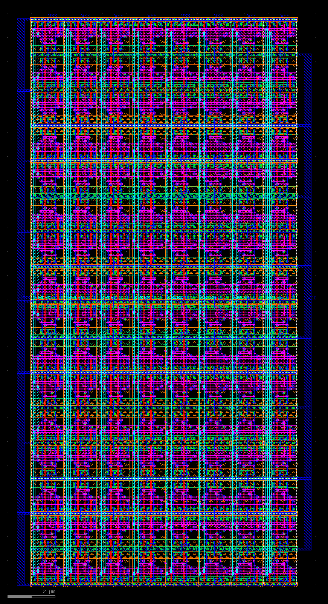
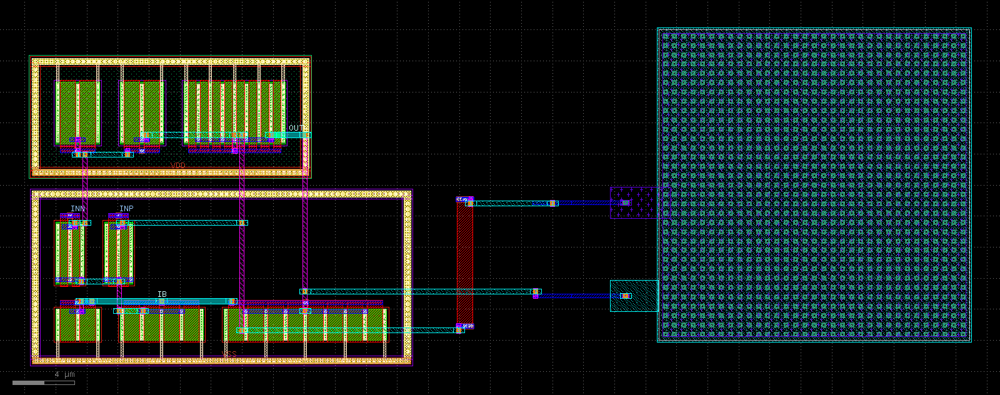
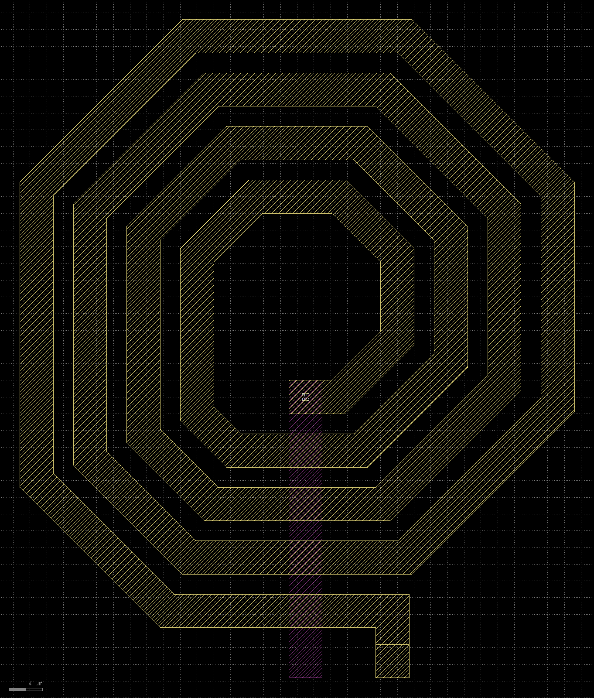
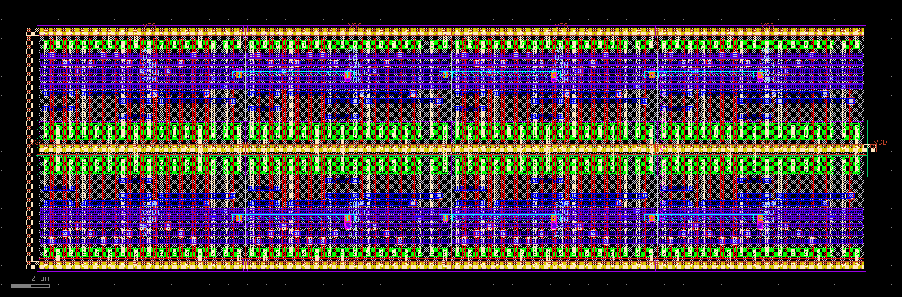

# ICL — a layered layout language for AI agents (SKY130)

ICL is one language with four libraries, so an agent can work at whatever level the task
needs and get signoff-checked results (magic DRC `drc(full)` + netgen LVS, sky130A decks):

| level | block | library | the agent controls | example |
|---|---|---|---|---|
| 1 | `stdcell` | geom | every shape, defined *relative* to others: `enclose nd nsdm`, `rect diff above=ptap`, `cross [nd,pd] poly ext=min`, `array licon in=nd left_of=g` — `min` resolves to the rule | `examples/l1_stdcells.icl` |
| 2 | `cell` | assembly + patterns | PCell transistors, `place … right_of / above / at`, `pair` (mirror symmetric), `interdigitate ABBA`, `common_centroid AB/BA`, dummies, `abut`, taps, guard rings | `examples/l2_analog.icl` |
| 3 | `floorplan` | floorplan | blocks (ICL cells or real `pdk:sky130_fd_sc_hd__*` cells), DRC-aware abut/spacing, `proximity` reports, chip I/O pins | `examples/l3_chip.icl` |
| 4 | all | route | `route … width= space= avoid=NET:um shield= maxres= prefer=`, `route A B symmetric axis=`, manual `wire … path=[…]` / `from= to=`, `keepout`, `limit coupling` | all of the above |

The language reference for agents is **[AGENTS.md](AGENTS.md)**.

**The canvas** (`icdsl/canvas/`, reference **[CANVAS.md](CANVAS.md)**) is the second interface: plain
Python scripts, any layer and any polygon, the PDK as one data file. It runs on **sky130A (130 nm),
gf180mcuD (180 nm) and freepdk45 (45 nm)**, each checked by magic DRC, the PDK's own KLayout DRC deck
and netgen LVS. It has the same levels as ICL, from shapes (`rect`, `polygon`, `path`) over PCells
(`via`, `mos`, `resistor`, `capacitor`, `guard_ring`), stick cells and a router up to
`TOP = from_spice("netlist.spice")`, which lays out a whole netlist. The larger benchmark
(`bench/xl`, 8 tasks on 3 PDKs, up to 768 transistors) and its LLM runs (`agents/README.md`) use it.

A fourth PDK, **asap7 (7 nm FinFET)**, is ported up to the device level: shapes and `mos` / `tap` /
`via` on the fin and gate grids, checked by the PDK's KLayout DRC deck, a KLayout extraction and
netgen LVS (no magic tech file and no LVS deck exist for it). `tests/asap7/` has an inverter, a NAND2
and an 8-transistor gated ring oscillator that are clean under the deck with an LVS match. Stick
cells, the router, `from_spice` and the benchmark are not ported to it (CANVAS.md, section 11).

| 16 x 8 SRAM, freepdk45 (45 nm) | Miller OTA, sky130A | spiral inductor, gf180mcuD | 8-bit adder, sky130A |
|---|---|---|---|
|  |  |  |  |

(reference layouts of the larger benchmark, all 22 in [bench/xl/README.md](bench/xl/README.md))

Slides are in `slides/`: `icl_overview.pptx` (the ICL language), `icl_results.pptx` (the agent
experiments on SKY130) and `icl_canvas.pptx` (the canvas, the three PDKs, the larger benchmark and
its LLM runs). Each is built by a script next to it:
`cd slides && npm install && NODE_PATH=$PWD/node_modules node build_canvas_deck.js` (the theme helper
`apply_theme.js` is loaded from the local path in `SKILL` at the top of each script).

```
$ bin/icl check tests/canvas/strip.py --pdk freepdk45
DRC (magic drc(full) freepdk45): clean
DRC (KLayout, drc_freepdk45.lydrc): clean
LVS (netgen): match - Circuits match uniquely.  devices layout/ref 2/2, nets 3/3
```

```
$ bin/icl check examples/l3_chip.icl --top chip
== chip  30.00 x 26.00 um  ->  CLEAN  (9.4s)
DRC (magic drc(full) sky130A): 0 violation(s)
LVS (netgen sky130A_setup): MATCH - Circuits match uniquely.  devices [5, 5] nets [13, 13]  pins_equivalent=True
```

## Results (all DRC 0 / LVS match, `tests/run_examples.sh`)

| level | cell | what | size µm |
|---|---|---|---|
| 1 | `inv1` | hand-built inverter, relative geometry, met1 pins | 1.38 × 2.72 |
| 1 | `nand2` | hand-built NAND2, output joined by the router | 1.84 × 2.72 |
| 2 | `ota_matched` | 5T OTA: ABBA input pair + dummies, 2×2 common-centroid load, 0.4 µm tail with maxres, keep-away, coupling budget, shielded bias | 7.36 × 12.88 |
| 2 | `diff_stage` | mirrored pairs, ptap/ntap guard rings, outputs routed as exact mirror images, 0.2 µm wires with 1 µm keep-out | 8.28 × 11.04 |
| 2 | `inv`, `nand2`, `ota5t`, `strongarm`, `dff`, `ring5` | row-template mode (automatic) incl. 20-transistor flip-flop, hierarchical ring oscillator | — |
| 3 | `chip` | diff stage → OTA → ICL inverter → ICL NAND → PDK `inv_2` (+ PDK tap cell), I/O pins on edges, 0.5 µm supplies | 30 × 26 |

LLM experiment: `agents/` drives a free model (nvidia/nemotron-3.5-super-vl:free) to write
parametric standard cells and sweeps W/L/height — see [agents/README.md](agents/README.md).

Random testing: `tests/fuzz.py` (row template) and `tests/fuzz_free.py` (free placement,
patterns, constraints) generate cells; every design that compiles must pass DRC + LVS.

## How it stays correct (and why agents can use it)

* **Rule knowledge lives in the tool.** `min`, `gap=min`, `by=min`, `ext=min`, `space=min`
  resolve from the SKY130 rule table for the layers involved; PCells and patterns are
  correct by construction; wells/implants are merged and neck-repaired automatically.
* **Compaction instead of coordinates.** Relative placement solves for the smallest legal
  position over every layer pair; explicit gaps below the minimum are errors naming the rule.
* **Block-aware floorplanning.** Blocks abut only when their facing layers merge legally
  (same well / implant / same-net rail); otherwise the minimum legal gap and the binding rule
  are reported. `proximity A B` lists the facing layers and their distance to the edge.
* **Geometric router.** A* on a grid, but legality is decided on real geometry with the
  spacing for each pair of nets, so custom widths, keep-outs, shields and symmetric routes
  cannot create spacing errors; off-grid pins get contact + stub access; notches from wide
  wires are filled; min-area is repaired; rip-up and retry on failure.
* **Feedback in DSL terms.** Line numbers + hints for compile errors; a fast in-process DRC
  (KLayout region engine) with statement attribution at level 1; magic DRC errors annotated
  with the DSL objects under the marker; GDS net labels so netgen reports DSL net names;
  dangling-net and pin-access warnings; route report (length, cuts, R, coupling).

## Layout

```
icdsl/syntax.py        shared statement + expression syntax
icdsl/tech.py          SKY130 layers, rules, routing stack, R/C data
icdsl/design.py        blocks -> libraries, imports, hierarchy
icdsl/lib_geom.py      level 1        icdsl/drc_lite.py   fast DRC with attribution
icdsl/lib_assembly.py  level 2        icdsl/lib_rows.py   row template mode
icdsl/devices.py       MOS arrays (patterns, dummies), taps, guard rings
icdsl/lib_floorplan.py level 3        icdsl/foreign.py    PDK std cells as blocks
icdsl/lib_route.py     level 4        icdsl/router.py     constraint-aware router
icdsl/signoff.py       magic / netgen icdsl/cli.py        icl check|build|inspect|render
```

## Setup

`tools/build_tools.sh` builds magic 8.3 and netgen 1.5 from upstream into `tools/install`
(user-local; `-std=gnu17` needed with GCC 15), creates the venv (`klayout`, `ciel`) and
fetches the three PDKs with ciel into `pdk/` (sky130A, gf180mcu, freepdk45; about 2.8 GB) and three
ASAP7 files (DRC deck, layer table, standard-cell GDS; 2 MB, sha256-checked) from
OpenROAD-flow-scripts at a pinned commit. Then
`bin/icl …`. None of that is in the repository: `pdk/`, `tools/install` and `.venv` are local.

The second DRC judge (the PDK's KLayout deck) needs the `klayout` program, 0.30 or later, on `PATH`
or as `tools/install/bin/klayout`. Without it that check is left out and only magic DRC and LVS run.

The run records (`agents/*runs*/`, `agent_compare*/`, `library/`) keep what was written (prompts,
model replies, scripts, feedback, results) and the layouts built from it (GDS, PNG, SVG; about
520 MB). The intermediate files of the signoff tools (extraction, DRC and LVS output) are not
stored; `bin/icl check` or `bench/xl/judge.py` rebuilds them. `build/` and `out/` are scratch.

## Limits

These limits are those of the ICL language (`.icl`). They do not apply to the canvas (`.py` scripts, [CANVAS.md](CANVAS.md)): any layer, any polygon, resistors / MIM capacitors / any declared device, sky130A, gf180mcuD and freepdk45 (asap7: shapes and `mos` / `tap` / `via` only). Use the canvas when a task does not fit ICL.

1.8 V nfet/pfet only; routing met1–met4; resistance and coupling are estimates (sheet/via R,
sidewall C); KLayout's official DRC deck is not run (magic is the DRC signoff); no antenna or
density checks; no post-layout simulation.

## License

Copyright (C) 2026 ibrahim-me. This project is free software under the GNU General Public License,
version 3; see [LICENSE](LICENSE). It comes without any warranty.

Third-party material keeps its own licence. `library/hd` and the layouts that place `pdk:` cells
contain data derived from the SkyWater `sky130_fd_sc_hd` library (Apache-2.0). The PDKs and the tools
(magic, netgen, KLayout) are fetched or built by `tools/build_tools.sh` and are not part of this
repository.
